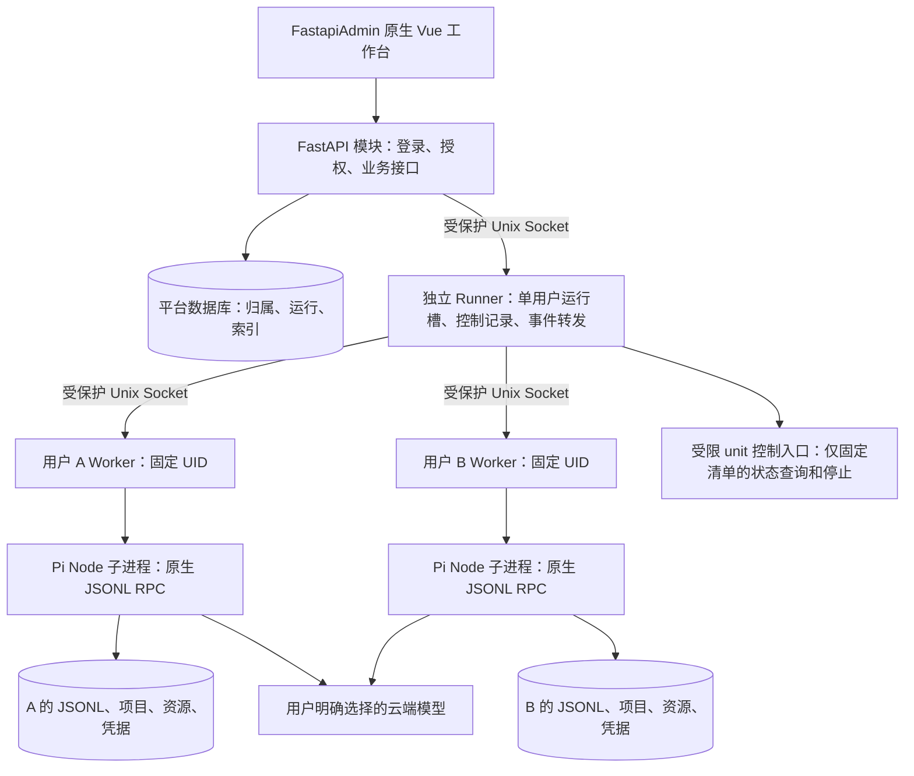
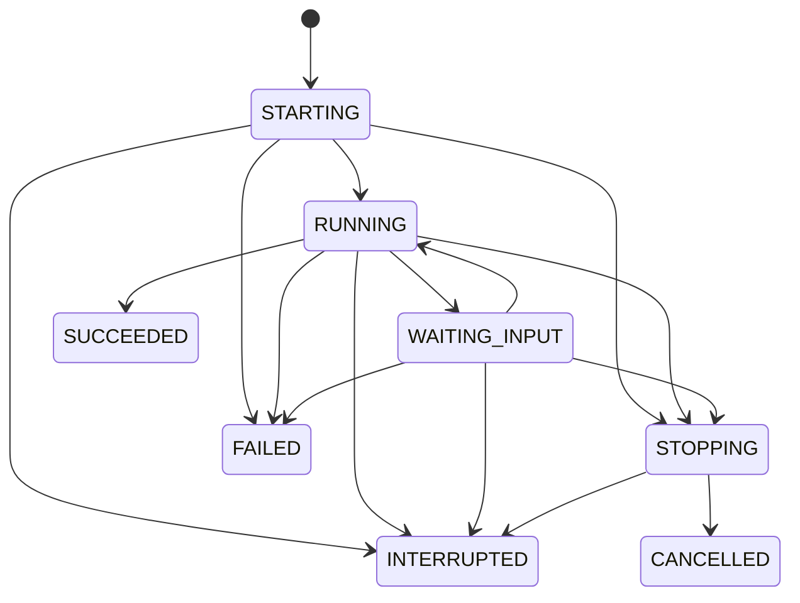

# FastapiAdmin 私有化个人 AI 工作台｜开发就绪 PRD

> v1.0｜2026-09-28｜对应 [最终版 PRD](./PRD-FastapiAdmin-Pi-Final.md) 的 F01～F12。
>
> 本文固定开发契约、实施顺序和验收方法，不增加产品功能。可以据此建立模块、实现接口和编写测试；真实运行兼容性须通过 G0，上线须通过 G2。本文所有运行测试当前均为“未执行”。

## 1. 实施基线

首版采用单机 Linux、共享 FastapiAdmin、每用户固定系统身份及个人目录、Pi 原生 RPC、JSONL 会话。无用户容器、沙箱平台、消息队列平台、多节点调度或数据库会话引擎。

| 项目 | 开发基线 |
| --- | --- |
| 系统 | 首个验证目标为 Ubuntu Server 24.04 LTS x86_64、systemd、cgroup v2；其他系统须重新验证部署脚本 |
| 业务栈 | 复用选定 FastapiAdmin 版本的 Vue3/TypeScript/Element Plus、FastAPI、数据库及既有依赖；不顺带更换平台数据库 |
| Pi 集成 | 使用 coding-agent 原生 `--mode rpc` 子进程；Python 只做授权、运行管理和协议适配，不实现 Agent 推理循环 |
| 凭据 | 一期固定为个人 API Key；可由企业向员工分配，但不得把平台级高权限密钥注入用户进程 |
| 模型 | 一期至少一个实际验证的云端 provider/model/API 组合；二期才适配 qwen-3.8-27B |
| 存储 | 个人目录的 Pi JSONL 为会话主存储；平台数据库保存归属、运行元数据及列表索引 |
| 并发 | 每用户一个活动运行或资源变更操作；全局默认五个；忙时拒绝，无持久等待队列 |

源码评估固定提交见第 13 节。G0 将实际部署的 FastapiAdmin 提交、Pi 包名/版本/构建提交、Node/Python 版本、锁文件、系统版本和云模型组合写入版本清单；不能用浮动 `latest` 交付。源码评估提交不等于已认证的发布组合。

## 2. 组件和执行身份



### 2.1 唯一业务授权入口

- FastAPI 从已有登录态取得 `user_id`，查询所有权后生成内部请求。浏览器不能指定 UID、宿主路径、环境变量或任意 Pi RPC。
- Runner 是独立系统服务，不随某个 HTTP 请求、WebSocket/SSE 连接或 FastAPI 进程退出而退出；不建立另一套用户或角色。
- Worker 是固定用户身份下的小型适配进程，处理受限文件操作、资源安装和 Pi stdio；属于内部实现，不能被浏览器直连。
- 员工默认只能操作本人资源。运维权限只增加运行元数据查看、停止、限额及恢复工具，不默认增加他人会话正文或文件的应用读取入口。宿主 root/备份管理员仍有主机层权限，不作“运维无法读数据”的承诺。

### 2.2 系统身份与生命周期的落地方式

1. 运维脚本预创建专用账号、个人目录和每用户固定 systemd service/socket；20～30 人规模不建设在线系统账号编排平台。未完成映射的账户显示“运行环境未配置”。
2. `user_id → runtime_key → UID/GID → 根目录 → unit` 一一映射，受保护配置由运维维护；数据库保存映射引用。两边不一致即拒绝执行，不自动推测或复用旧 UID。
3. Worker 使用 socket activation，`Accept=no`，每用户只有一个固定 service；接收 systemd 传入的监听 FD。socket 及父目录由运维维护、只允许 Runner 连接，Worker 再校验连接方系统身份。不能采用每次连接生成一个独立执行实例的模式。Runner 按固定 socket 绑定用户，不相信 Worker 消息自报的 owner；连接后先握手核对启动标识、当前运行 ID 和 Pi 状态，再投递任务。
4. service 使用固定 `User`、固定绝对 `ExecStart`、受控环境和 `KillMode=control-group`；系统账号无交互登录、sudo、可写 unit 或 cgroup 委派，并禁用通过 SSH、cron、at、user manager 等另建未受管进程的入口。Worker 使用固定 Python 解释器及隔离导入模式，不从用户 cwd/PATH 加载控制程序；Pi/Node 也使用平台绝对路径。Pi、安装脚本及派生进程必须留在受管理范围。
5. Runner 与 Web 均非 root。超时强停通过部署时授予的窄权限入口执行：只能查询、停止预配置清单中的个人 unit，不能提交命令、设置属性、创建 unit 或停止任意系统服务。员工进程没有该权限。该入口必须实际测试，不能假设非 root Runner 可直接 kill 其他 UID。
6. Runner 重启先查询遗留 Worker/unit，对失去确认的运行记录标记中断，停止并核对遗留执行后再接受新运行；不自动续发可能已执行的提示词。FastAPI 重启只重新接入 Runner；普通 UDS 断线本身不是取消命令。停止失败则隔离该运行槽并提示运维，不能放行第二个写入者。

Worker 与 Pi 同 UID，不能将 Worker 当作抵御本人恶意扩展的独立安全边界；它不持有平台数据库或管理凭据。控制面审计来自 FastAPI/Runner，不把 Worker 自报结果当作防篡改证据。

systemd 的 socket 激活、资源控制和整组停止语义以 [socket 文档](https://github.com/systemd/systemd/blob/v255/man/systemd.socket.xml)、[资源控制文档](https://github.com/systemd/systemd/blob/v255/man/systemd.resource-control.xml)、[停止语义](https://github.com/systemd/systemd/blob/v255/man/systemd.kill.xml) 为依据；部署系统上的实际行为列入 G0。

### 2.3 文件布局与访问规则

```text
/opt/pi-runtime/                         # 运维维护的 Pi/Node/Worker，用户只读
/var/lib/pi-control/                     # Runner 私有控制记录，员工不可访问
/run/pi-control/                        # 平台内部 socket，禁止公开 HTTP 入口
/srv/pi-workspaces/u_<runtime_key>/      # 该 UID 的私人根目录，0700
  projects/<project_uuid>/               # 项目工作目录
  .pi/agent/                            # 个人 Pi 配置、凭据、扩展、Skills
  sessions/                             # 显式指定的 Pi 原生会话目录
  packages/                             # 个人 npm 前缀、Python 虚拟环境等
  trash/                                # 已删除会话的保留目录
  tmp/                                  # 该用户临时文件，纳入磁盘配额
```

每个子进程显式设置本人 `HOME`、Pi 配置目录、会话目录、工作目录及包管理路径；使用干净环境白名单，不能通过改写共享进程全局环境切换用户。云密钥不放在命令行参数中。

文件 API 的路径限于指定项目内的相对路径。拒绝绝对路径、`..` 越界、特殊设备和越界链接；首版文件 API 不跟随符号链接。检查与打开必须结合目录 FD/禁止跟随链接等机制避免重命名竞态，不能只校验一次路径字符串。文件读写、会话读取和索引扫描在目标用户权限下进行，Web 不以 root 直接读取用户提供的路径。

不同 UID 不提供私有网络命名空间。平台控制接口使用受保护 socket；数据库、缓存和本机 HTTP 服务不能仅凭“监听 localhost”免认证。首版不发布用户服务或提供端口预览；用户自行启动的无认证网络服务不在私人资源保证内。安装代码可读本人文件和本人凭据，不能宣称同一 UID 内隔离扩展与敏感项目。

## 3. FastapiAdmin 接入规范

按现有插件示例建立 `backend/app/plugin/module_pi/`，按 `controller / service / crud / model / schema` 分层；路由经现有机制注册，业务数据通过现有 ORM 和 Alembic 迁移。前端进入既有菜单、路由、权限指令和请求封装，禁止嵌入原 pi-web 页面。

权限命名采用现有 `模块:资源:动作` 格式，例如 `module_pi:session:query`、`module_pi:run:start`、`module_pi:runtime:manage`；登录态和按钮权限不能代替数据库所有权过滤。普通员工与运维角色的菜单/权限通过可重复执行的初始化脚本配置。参考 [插件控制器示例](https://github.com/fastapiadmin/FastapiAdmin/blob/1cd12c726ad9032c17ef85ce805ce991be60fbdf/backend/app/plugin/module_example/demo/controller.py)。

普通 REST 返回复用 `ResponseSchema/SuccessResponse` 和既有分页结构；本文的错误标识放在统一错误详情中，不再引入平行响应协议。文件下载和 SSE 按流式响应处理，仍走相同鉴权和异常映射。密钥、消息正文、上传内容等接口必须显式关闭通用操作日志的请求体采集，并验证异常日志也已脱敏。

## 4. 数据契约

表名可适配仓库命名规则，以下字段及约束必须保留。

| 实体 | 必要字段/约束 | 权威性 |
| --- | --- | --- |
| `PiUserRuntime` | 唯一 `user_id`、唯一 `runtime_key`、预配置 UID/GID 引用、配额、状态 | 运行身份映射；不存 root 能力或凭据 |
| `PiProject` | UUID、`owner_id`、显示名、服务端生成的相对目录、创建时间 | 项目所有权，目录不随重命名变化 |
| `PiSession` | UUID、`owner_id`、`project_id`、原生 session ID、受约束相对文件引用、绑定状态、索引状态、删除状态 | 所有权和关联不可从文件重建；标题/摘要/更新时间是可修复索引 |
| `PiRun` | UUID、`owner_id`、会话/项目、类型、幂等键、请求摘要、状态、时间、错误类型、结果是否未知 | 对话必须绑定会话/项目；资源操作和模型测试可为空，不能隐式继承当前会话；复用同一运行槽 |
| `PiUserPreference` | 唯一 `user_id`、选定模型标识、非秘密 UI 配置 | 业务设置，不保存第二份可独立修改的 Pi 资源清单 |

用户、角色、操作审计复用平台已有实体。个人 API Key 与 Pi 资源配置由 Worker 管理在本人 Pi 配置目录内，凭据文件权限为 0600；API 只返回“已配置/未配置”及掩码，不能回传密钥。配置文件更新采用原子替换并校验已有版本，保留未知字段，避免覆盖用户自己的配置。

### 4.1 JSONL 与索引

- 不实现 agent-core `SessionStorage` 来替换 coding-agent。两套存储抽象不能视为可直接互换；本期使用 coding-agent 自身持久化能力。
- 服务端分配平台会话 UUID，并通过已核对的原生 `--session-id` 能力以确定性 ID 创建会话；Pi 实际返回的会话路径须位于配置目录，再写入绑定。绑定状态为 `CREATING/READY/ERROR`，首个 prompt 之前必须完成身份及路径绑定；未写入首条消息时物理文件可暂不存在，不能视为丢失。
- 创建途中中断保留 `CREATING` 及确定性 ID，按该 ID 和目录对账，确认结果后才转 `READY`；不另建第二份，也不能用“最近会话”补绑。CLI 参数和首次落盘时机仍须在 G0 对锁定构建实测。
- 新建、继续、改名通过 Worker/Pi 协调；不由 Web 手工拼接 JSONL。Pi 是正常路径下唯一会话写入者，索引不回写正文。
- 历史展示读取原生条目并转为 UI 视图，保留自定义条目、工具与压缩语义；未知条目可降级展示，但不能从源文件删除。
- 索引修复只遍历数据库已授权的映射范围。未知 JSONL 标为未关联，不根据文件头的用户名或 owner 字段自动认领，更不能重新授权。
- 尾部截断、损坏行、外部修改等情况保留原件并标记异常；可展示完整前缀，恢复写入前须诊断。不得静默重写整个文件或把异常历史当作空会话。
- 同一 UID 的任意代码能修改自己的 JSONL；平台不把它当作防篡改审计。受保护的控制记录只存运行 ID、摘要、状态和调度事件，不建设第二份会话正文存储。

### 4.2 删除、重命名及文件并发

会话删除采用 `DELETING → DELETED` 可重试流程：锁定用户操作槽、拒绝新运行、将对应 JSONL 移至本人 `trash`、记录墓碑并隐藏列表。异常时保留 `DELETING` 供对账，不能谎报完成；不删除项目文件。默认保留七天，由空闲时清理任务删除；不建设回收站 UI，恢复由运维处理。

会话创建/删除/改名、模型或凭据修改及资源变更，与运行提交共用用户互斥控制；不能只在执行前查一次“是否空闲”。短操作不必创建完整 PiRun，但须有可对账的操作标识；需要 Pi 加载另一会话时先结束旧会话进程，禁止两个正常写入者并存。运行期间拒绝上述操作；项目重命名只改显示名，可正常进行。

Agent/安装等活动操作期间，浏览器文件面板只读和下载，禁止上传、保存及覆盖。空闲写文件同样占用用户短操作锁，并确认受管 Pi/工具写入已结束；文件 Worker 不因普通文件请求加载用户扩展。文本保存再比较内容版本/ETag，多标签页旧版本返回 `FILE_CONFLICT`，允许重新加载或另存。新上传默认不覆盖同名文件。ETag 不被当作可阻止任意外部进程写入的事务机制；活动任务期间读取的文件仍可能变化。

## 5. 运行协议与状态机

### 5.1 接受一次请求

1. 前端生成 `Idempotency-Key`，正文包含平台会话 ID、用户文本和受授权文件引用。后端取得用户身份，校验模型、归属、账户状态和运行槽。
2. 数据库唯一约束为 `(owner_id, idempotency_key)`。同键同请求摘要返回同一 `run_id`；同键不同正文返回 `IDEMPOTENCY_CONFLICT`，包括前次已终结的情况。
3. 短事务建立 `STARTING` 记录并占用用户槽；同用户其他活动请求返回 `USER_BUSY` 和本人当前运行 ID。唯一槽采用事务锁/唯一约束保障，不只用 Web 进程内变量。
4. 单实例 Runner 检查全局容量，将 `run_id + 摘要 + 投递阶段` 写入受保护控制记录并落盘，再确认接受。没有容量则结束准备记录并返回 `CAPACITY_FULL`；不排队。
5. Runner 向唯一 Worker 投递。Worker 去重并执行，Pi `prompt` 不由浏览器直接发送。API 返回接受结果只代表接受，不代表任务完成。
6. Web 重试只能查询/重复同一运行控制请求。投递结果不确定时不自动重新发 `prompt`；Runner/Pi 崩溃后的未知结果为 `INTERRUPTED`，用户核对后用新的运行 ID 再发起。

FastAPI 启动及每三十秒执行一次非终态对账：Runner 可用且持有活动运行时同步状态，不能因 Web 超时停止健康运行；已保存终态时回填数据库。超过六十秒仍未建立投递结果的 `STARTING`，先请求 Runner 原子关闭该控制 ID：无投递记录时写入关闭标记，阻断迟到的启动请求，确认未执行后转 `FAILED` 并释放槽；已投递但结果不明则停止、核对受管执行，再转 `INTERRUPTED`。Runner 不可达时保持待对账和占槽，不能凭本地超时释放。全程不补发原 prompt。

内部控制记录是运行投递日志，不是消息队列，不保存完整提示词。它用于防止超时重试盲目执行两次，不承诺模型工具对外部系统的副作用“恰好一次”。活动控制记录不得清理；终态记录、数据库运行记录及幂等键默认共同保留三十天，过期后的新提交不承诺仍命中旧请求。容量拒绝等已知未执行结果不自动转成排队；用户明确重试时生成新幂等键。

### 5.2 状态和终态来源



| 状态 | 触发与含义 |
| --- | --- |
| `STARTING` | 已分配运行记录、正在检查和启动；不表示进入等待队列 |
| `RUNNING` | Worker 已确认任务进入执行流程 |
| `WAITING_INPUT` | Pi 发出受支持的输入请求，仍占用运行槽 |
| `STOPPING` | 已接受停止请求，执行尚未确认结束 |
| `SUCCEEDED` | 收到锁定 Pi 版本的 `agent_settled`，对账确认无待处理回合、输入或终结错误；资源操作则以进程成功退出及配置校验为准 |
| `FAILED` | 已知启动/模型/协议/资源操作失败，且确认执行结束；普通工具报错可由 Agent 继续处理，不直接等同整个运行失败 |
| `CANCELLED` | 已请求停止，且受管理执行及派生进程已确认停止；不表示撤销此前文件修改或外部请求 |
| `INTERRUPTED` | Pi/Runner/主机异常退出，或不能确认真实终态；副作用可能已发生，不自动重放 |

终态持久化和受控执行清理后才释放槽。Pi 的普通命令 `response.success` 仅代表命令响应；`agent_end` 也可能早于重试、压缩和后续处理结束，不能用来提前宣布成功。接近停止与完成的竞态按 Runner 已确认的终态处理，不把已完成任务改成已取消。依据 [Pi RPC 生命周期](https://github.com/earendil-works/pi/blob/7c696c00f34cf773c86d33093de8d5711994c5e4/packages/coding-agent/docs/rpc.md)。

### 5.3 RPC 适配与停止

- 使用固定平台 Pi/Node 绝对路径。用户对话新建时显式传入服务端分配的原生 session ID 和会话目录；继续时使用校验后的精确会话路径；不得用“最近一次会话”来定位，持久对话不得启用 `--no-session`。
- 先建立事件读取再发送 `prompt`；命令 ID 与响应 ID 对应，不能按响应先后顺序关联。RPC 按 LF 分帧，不能把 `U+2028/U+2029` 当换行。stderr 单独处理，stdout 持续读取，浏览器慢速或断线不能阻塞 Pi。
- 首版只封装必要的 prompt、abort、状态/历史、模型、会话名称和扩展输入回应，不暴露通用 RPC 透传。`steer/follow_up` 不作为前端发消息的隐式行为。
- 停止先发 Pi `abort`；默认十秒未结束则通过受限入口停止整个个人 unit，systemd 停止宽限默认五秒后强制结束受管进程。对话、安装和连接测试均可停止。
- 不可中断的内核 IO 等情况可能无法按时清除：保持“停止异常”诊断、标记结果未知并冻结运行槽，不能显示已取消后立即开启下一运行。
- 首版不保证脱离本次操作的后台服务持续运行。普通回合结束时清理不应残留的工具子进程；闲置 Worker/Pi 可回收，再从 JSONL 继续。包、文件及会话不随进程退出删除。

### 5.4 浏览器恢复与事件协议

使用携带已有登录凭据的 fetch SSE；令牌不放在 URL。事件最小结构为 `event_id = runner_epoch:seq`、`run_id`、`type`、`data`；心跳默认十五秒。前端按事件 ID 去重，断线携带最后已见 ID 重连。

Runner 为每个活动运行保留最多 2 MiB 或五分钟的事件缓冲，并维护当前状态和未完成文本快照。缓冲缺口返回 `resync_required`，前端重新读取持久历史及当前运行快照，并提示临时输出可能不完整；不能为补增量重新运行任务。快照附带事件高水位，后续订阅从该水位之后开始，避免“取快照—订阅”间丢事件。

FastAPI 重启后以数据库与 Runner 对账；只有 Web 连接消失时不得取消执行。Runner、Pi 或主机重启不提供无缝续跑。账户停用立即拒绝新操作，主动撤销连接；撤销事件丢失时，订阅权限复核最多十五秒内关闭旧连接，并按停止流程终止执行。

## 6. 扩展、资源和模型的最小接口

### 6.1 扩展交互

| Pi 请求 | Element Plus 表现 | 回应规则 |
| --- | --- | --- |
| `select` | 单选对话框 | 返回对应选项或取消 |
| `confirm` | 确认对话框 | 明确确认/拒绝，禁止默认批准 |
| `input` / `editor` | 单行/多行输入 | 返回文本或取消 |
| `notify`、基础状态信息 | 通知/运行状态区域 | 无需伪造用户回应 |
| 自定义 TUI/复杂渲染 | 明确“不支持此扩展界面” | 有等待 ID 的请求返回协议支持的取消/失败；不能安全回应则中止本次运行并说明原因 |

`extension_ui_request.id` 对应一次响应；过期或重复回应不能误投到下一次对话。断线期间保留等待项，重连再展示；默认十分钟未回应记录 `INPUT_TIMEOUT`，进入 `STOPPING` 并走统一 abort、清理及终态判定。不能仅发送 UI 取消响应就宣布运行停止，因为扩展可能继续。unsupported UI 不无限等待，需要结束运行时也走同一停止流程。方法和字段按 [Pi 扩展 UI 协议](https://github.com/earendil-works/pi/blob/7c696c00f34cf773c86d33093de8d5711994c5e4/packages/coding-agent/docs/rpc-extension-ui.md) 固定。

### 6.2 个人资源

- 资源页展示已配置包、Skills/扩展、启用状态、加载错误和生效时间；支持来源安装、更新、禁用、启用和卸载。不建设搜索市场。
- Pi 包使用固定引擎的 `pi install <source>`、`pi remove <source>` 和仅针对扩展包的更新命令；参数按数组传递，不能拼接 shell。不得将普通“更新资源”实现为更新平台 Pi 本身。
- 启停通过版本匹配的资源配置过滤完成；不调用依赖 TUI 的 `pi config` 当作无头 API。操作前后读取配置并核对结果，下一次 Pi 进程加载生效。
- npm 使用个人前缀，Python 使用个人虚拟环境；项目内依赖可由 Pi 工具安装。允许个人安装代码执行，不增加逐包审批；系统包、服务与共享库由运维维护。
- 安装/更新占用同一用户运行槽；忙时返回冲突。失败保留诊断，不自动回滚任意第三方安装脚本产生的全部副作用，用户可修复或重新安装。
- 个人范围默认加载；首次使用项目内可执行资源前显示一次项目来源信任说明，由用户授权，不设置管理员审批流，也不自动信任上传或克隆仓库中的配置。无头信任参数行为纳入 G0。

Pi 包的安装位置、资源筛选及更新区别依据 [Packages](https://github.com/earendil-works/pi/blob/7c696c00f34cf773c86d33093de8d5711994c5e4/packages/coding-agent/docs/packages.md) 和 [CLI](https://github.com/earendil-works/pi/blob/7c696c00f34cf773c86d33093de8d5711994c5e4/packages/coding-agent/docs/cli.md)。

### 6.3 云端模型

管理员配置首版已验证的 provider/model/endpoint 清单，用户填写本人密钥并主动选用。连接测试通过同一受管执行路径发出最小请求，不携带已有会话或工作区内容，显示连通/权限/限流等结果；测试同样受并发限制。

连接测试在空临时工作目录及独立临时 Pi 配置目录启动单独调用：使用内存会话，禁用工具、扩展、Skills、上下文文件和项目本地配置，只带选定模型所需的个人配置/凭据及固定测试文本；不复用用户对话进程或整份个人配置。测试完成清理临时目录。此测试例外不改变正式对话必须 JSONL 持久化的规则。

运行冻结本次模型配置版本，忙时不改密钥或模型；没有自动供应商回退。配置界面和首次云端运行明确说明提示词、上下文和工具结果可能外发。同 UID 的扩展可读本人 Key，因此不注入跨用户共享的高权限云凭据。

二期仅在此接入内网适配器与模型配置；数据出口、扩展网络和敏感会话切换需要另行验证，不能仅增加一个“本地”下拉项就宣布完全私有化。

## 7. HTTP 接口清单

下列 `/pi` 为模块路由，前缀由 FastapiAdmin 统一配置。所有资源查找同时约束 owner，越权 ID 与不存在 ID 均返回不暴露归属信息的结果；分页和参数定义在 OpenAPI 中固化。

| 方法/路径 | 输入与结果 | 权限/并发要求 |
| --- | --- | --- |
| `GET/POST /pi/projects` | 本人项目分页 / 创建显示名 | 从登录态取得 owner；目录服务端生成 |
| `PATCH /pi/projects/{id}` | 重命名显示名 | 不移动真实目录 |
| `GET /pi/projects/{id}/files` | 相对目录、文件元数据 | 本人项目；有条数/深度上限 |
| `GET /pi/projects/{id}/file` | 相对路径；文本/预览/下载模式 | 受限读取；下载无永久公共链接 |
| `POST /pi/projects/{id}/files` | multipart 上传、目标相对路径 | 用户空闲；大小限制；默认不覆盖 |
| `PUT /pi/projects/{id}/file` | 内容、原版本/ETag | 用户空闲且占用短操作锁；冲突返回 `FILE_CONFLICT` |
| `GET/POST /pi/projects/{id}/sessions` | 本人会话分页 / 新建 | 新建与 Worker 绑定受控原生 ID |
| `GET /pi/sessions/{id}/messages` | 游标、页大小 | 返回持久历史和索引/文件异常状态 |
| `PATCH/DELETE /pi/sessions/{id}` | 标题 / 删除 | 用户空闲，操作可对账 |
| `POST /pi/sessions/{id}/runs` | 文本、文件引用、幂等键 | 接受后返回 `run_id` 与状态，HTTP 202；忙/满不排队 |
| `GET /pi/runs/{id}` | 状态、终态原因、快照及高水位 | 本人运行；不返回其他用户状态 |
| `GET /pi/runs/{id}/events` | SSE、最后事件 ID | 每次订阅和续期鉴权；缺口重同步 |
| `POST /pi/runs/{id}/cancel` | 无任意命令参数 | 可重复调用；终态不反转 |
| `POST /pi/runs/{id}/ui-responses` | 等待请求 ID、类型化响应 | 本人运行且等待项未过期；同 ID 去重 |
| `GET/PUT /pi/preferences/model` | 已验证模型选项/选定 ID | 空闲时修改；不接受任意引擎环境变量 |
| `PUT/DELETE /pi/credentials/{provider}` | 设置/清除本人密钥 | 空闲，禁日志正文；不提供明文 GET |
| `POST /pi/model-tests` | 模型 ID、幂等键 | 返回受管测试运行；不携带工作区 |
| `GET /pi/resources` | 本人资源、配置版本、加载状态 | 掩码敏感配置 |
| `POST /pi/resource-operations` | install/update/remove/enable/disable、来源或资源 ID、配置版本、幂等键 | 返回资源运行；固定执行器，不是任意管理 Shell |
| `GET /pi/admin/runs` | 运行元数据、配额错误 | 运维权限，不包含正文或密钥 |
| `POST /pi/admin/runs/{id}/cancel` | 停止原因 | 运维权限，独立审计 |

语义错误至少包括 `USER_BUSY`、`CAPACITY_FULL`、`IDEMPOTENCY_CONFLICT`、`FILE_CONFLICT`、`RUNTIME_NOT_READY`、`SESSION_CORRUPTED`、`UNSUPPORTED_EXTENSION_UI`、`QUOTA_EXCEEDED`。HTTP 409 表示状态/版本冲突，429 表示容量或频率限制并附重试提示；鉴权、参数和错误详情复用框架规范。

前端最少四个视图：项目/会话导航、对话和工具流、文件面板、个人模型与资源设置；运维复用平台管理页面。Markdown 禁止执行原始脚本，图片及下载限制 MIME；SVG/HTML 等主动内容默认下载，不同源执行。首版不建设任意代码预览服务器。

## 8. 默认参数与容量验证

以下是第一轮实施的明确默认值，属于可配置起点，并非压测结论。调整必须写入部署清单，不修改产品范围。

| 参数 | 默认值/行为 |
| --- | --- |
| 活动数 | 每用户 1，全局 5；对话、安装、模型测试共同计数 |
| 每用户执行资源 | CPU 上限约 2 核时间份额、内存硬上限 4 GiB、进程/线程数 192；所有个人执行合并计算 |
| 私人磁盘 | 每用户 20 GiB，JSONL、文件、依赖、trash、临时文件均计入；采用文件系统 UID 配额并实测，不用 UI 计数代替硬限制 |
| 上传/编辑 | 单文件上传 50 MiB；在线文本编辑/预览 2 MiB；超限提供下载或明确拒绝 |
| 提示词/文件列表 | 单次用户文本 64 KiB；文件树每页 200 项、禁止无界递归；历史默认 50 条、上限 200 条 |
| 交互/停止 | 输入等待十分钟；abort 宽限十秒；unit 停止宽限五秒；无法清理则冻结运行槽 |
| 事件 | 每运行 2 MiB/五分钟缓冲；十五秒心跳/权限复核；无无限日志缓存 |
| 空闲回收 | 无活动运行十分钟后可关闭个人运行进程；受管后台任务不承诺长期保活 |
| 会话删除保留 | 七天；凭据删除立即停止后续使用，但历史备份按既定保留期清理 |
| 备份 | 每日维护窗口内静止备份，默认保留七份；备份位置在客户控制范围内 |

CPU/内存/进程数用 systemd/cgroup 限额；磁盘用文件系统配额。禁用用户 cgroup 逃逸路径；包管理缓存、临时目录不能绕过磁盘约束，宿主共享 `/tmp` 等可写位置也要纳入 UID 配额或部署约束。IO 争用和共享内核故障不保证完全互不影响。

验收参考机可先按 **16 vCPU、64 GiB 内存、1 TB SSD** 准备，备份另留空间，不含二期模型/GPU。30×20 GiB 的个人配额不等于启动时预分配 600 GiB 内存或磁盘文件，但存储容量必须容纳实际数据并预留平台、日志及余量。最终规格由五并发混合任务实测决定，不能把此值作为硬件性能保证。

容量验收记录 30 个账户、5 个活动运行、25 个登录/浏览用户下的平台接口 p95、错误率、CPU/内存/磁盘峰值。目标：本地普通列表/状态接口 p95 ≤ 1 秒、非注入错误的 5xx < 1%，无跨用户错投/串数据；模型响应时延单独记录，不与平台接口混算。增加到十并发前须重新验证。

## 9. 运维、恢复和审计

- 平台记录用户/运行 ID、时间、模型 ID、状态、错误类型和管理动作；默认不记完整消息、工具正文、密钥、环境变量。用户目录与备份包含敏感内容，按客户内部数据处理规则访问。
- 账户停用先阻止新任务和订阅，再终止受管进程；Runner 在每次激活个人 socket 前校验映射状态，不能仅锁定 Linux 密码。账户数据保留，重启不能让停用账号自动恢复执行。账号删除/UID 回收不作为首版自助功能。
- 备份进入维护窗口，平台维护锁覆盖新运行、资源变更、上传/编辑、项目和会话变更、模型配置及凭据写入；暂停 trash/索引等后台写任务。等待活动任务结束，必要时由运维明确停止；停止并核对全部个人 unit，维护期间 Runner 禁止重新激活 socket，文件读取入口也不能偷偷唤醒 Worker。数据库只读浏览可保留。
- 确认无受管写入者后，协调备份平台数据库、全部个人根目录、运行映射和版本清单；数据库采用其一致性备份机制。备份完成再解除维护锁及恢复后台任务。不要将一次运行中的裸目录复制称为一致性备份。
- 恢复到相同受支持基线：先恢复数据库与系统身份映射，再还原目录及 UID/GID/权限，再修复索引。未知文件不自动授权；重启前未完成运行标记中断，不重新执行。
- 备份演练需在干净环境实际读回历史、继续一条会话、下载产物，并证明 A/B 归属不变。默认恢复点最多损失最近一次成功每日备份之后的数据；恢复耗时由 G2 演练测量，不先宣称零丢失或分钟级恢复。
- 系统依赖由运维清单重建；个人目录备份不承诺跨 OS/Node/Python 大版本后所有二进制依赖可直接运行。备份失败必须可发现，不能只验证任务被启动。

## 10. 开发任务与里程碑

| 工作包 | 内容及产物 | 前置 | 覆盖 |
| --- | --- | --- | --- |
| W01 | 固定版本，两个 UID、service/socket、强停、配额、原生 RPC/JSONL/云模型验证；输出 G0 证据 | 部署验证机、一个测试云模型 | F01/F04/F06/F08/F11 |
| W02 | FastapiAdmin 模块、迁移、归属查询、菜单与权限初始化、运行映射 | 可与 W01 并行搭骨架 | F01/F02/F11 |
| W03 | Runner/Worker、幂等投递、状态机、取消、对账、SSE 与重连 | W01，W02 模型约定 | F05/F06/F07 |
| W04 | 项目/文件接口、原生会话绑定、历史、索引、改名和删除 | W02，W03 基础运行接口 | F02/F03/F04/F12 |
| W05 | 原生工作台界面、云模型/凭据、最小扩展输入交互 | W03/W04；先用协议模拟数据 | F05/F08/F10 |
| W06 | 资源页、个人包管理与依赖目录、配置冲突检测 | W01/W03/W05 | F09/F10 |
| W07 | 停用账户、诊断、配额、备份恢复与部署脚本 | W02～W06 | F01/F11/F12 |
| W08 | A01～A20、试用和容量报告、交付清单 | W01～W07 | F01～F12 |

**G0 必过项：** 两 UID 文件/凭据隔离；Worker socket 和强停入口不越权；Pi 版本的 `agent_settled`/取消/标准扩展 UI；项目信任无头行为；JSONL 新建/恢复/压缩后历史；一个真实云模型的流式和工具调用；内存/进程/磁盘限额。失败时先修复或收缩实现，不能以“接口已预留”进入上线阶段。

**G1 交付物：** 前后端代码、Runner/Worker、数据库迁移与权限脚本、锁定版本清单、单机部署脚本、自动测试、备份恢复脚本、已验证模型清单。不得以两个原项目的页面嵌入替代界面实现。

**G2 通过条件：** 下节全部用例有真实证据，无未关闭的严重越权/数据丢失问题；3～5 位员工覆盖开发、分析、办公任务试用；确认客户允许云处理的数据范围和备份位置。实际 endpoint、Key、主机信息是联调配置，不是产品决策待选项。

## 11. 验收用例与追踪

全部状态：**未执行**。实现团队逐项附版本、环境、步骤、实际结果及日志/截图/测试报告；文档审查不能将其改为“通过”。

| ID | 对应需求 | 步骤/故障注入 | 通过条件 |
| --- | --- | --- | --- |
| A01 | F01/F02 | A/B 各建项目、会话并重命名项目；交换项目/会话/文件/运行 ID，尝试下载和订阅 | 每个入口拒绝越权；重命名不改路径/归属；列表和错误不泄露 B 的数据；新用户未配置环境有明确提示 |
| A02 | F01/F03/F11 | A 用 Pi 与文件 API 尝试 B 根目录、平台凭据、绝对路径、穿越、符号链接及检查后重命名 | 不能读取/修改 B 与平台秘密；所有文件操作、预览、上传和索引路径均覆盖 |
| A03 | F01/F06/F11 | A 尝试内部 socket、伪造 UID/路径、任意 RPC、其他 unit 控制及无凭据本机管理端口 | 均不能获得平台控制或 B 数据；明确不把任意个人 HTTP 服务当作私有网络 |
| A04 | F02/F03/F05 | 上传文本/图片、双标签编辑；运行中尝试上传/保存；超限上传、下载产物、预览含脚本的 Markdown/HTML/SVG | 正常闭环；活动时拒绝写入；空闲旧版本不覆盖；超限有说明；主动内容不在平台源下执行 |
| A05 | F04/F12 | 新建/继续/改名，创建绑定中断后对账；含工具、自定义条目及压缩的历史；分页再重启读取 | 首个 prompt 前绑定；无重复创建/最近会话补绑；精确续接；原生条目不丢；无数据库正文平行主存储 |
| A06 | F06 | 双击、HTTP 接受响应丢失、多标签页并发；同键同文/异文；第六个用户提交；DB建记录后Web崩溃和迟到投递 | 同键最多投递一次；不确定窗口可零次并明确中断；异文冲突；忙/满无隐式队列；未投递记录可关闭，迟到请求不能执行 |
| A07 | F05/F06 | 模拟 RPC 响应乱序、LF 分帧、U+2028/U+2029、工具错误、重试/压缩、异常退出 | 不错配响应；不以 response/agent_end 提前成功；已知失败和未知结果可区分 |
| A08 | F06/F11 | 员工/运维停止模型流、长 shell、安装脚本及故意不响应 Worker；对停止与完成制造竞态 | 先停止中，按期限升级整组停止；确认后释放槽；无法清理则冻结并告警；不影响 B；运维列表无正文/密钥，管理停止有审计 |
| A09 | F07 | 运行时关闭浏览器，再从相同/过期事件游标重连，制造缓冲溢出 | 执行继续；历史与当前状态恢复；缺口明确；不重跑、不重复展示已确认事件 |
| A10 | F07/F06 | 工具执行时重启 FastAPI，保留 Runner/Worker | 运行继续；重新鉴权后对账；提示词不重发；终态正确 |
| A11 | F06/F07 | 分别杀 Pi、重启 Runner、模拟主机重启，覆盖投递前后窗口 | 不确定任务标中断；不盲目重放；遗留进程清理前不接受新写入者；数据仍可查看 |
| A12 | F01/F11 | 用户有活跃运行与多个订阅时停用账号，再尝试发送/重连/重启恢复 | 新操作立即拒绝，旧流最长十五秒撤销；受管进程停止或异常可见，不自动复活 |
| A13 | F08/F05 | 用真实已列出的云模型测试鉴权、流式、一次工具调用、限流/服务错误和取消 | 正常调用成立；失败无自动换供应商；连接测试不带用户文件；云端传输提示明确 |
| A14 | F08/F01 | 设置/删除 Key，检查操作日志、错误响应、进程参数与 A/B 运行环境 | 不出现其他用户或平台凭据；不能 GET 明文密钥；删除后无后续使用，备份保留边界可查 |
| A15 | F09/F11 | 安装一个工具扩展、Skill、npm/Python 依赖；升级/禁用/卸载，尝试系统级写入；安装与运行并发 | 个人安装无管理员审批，实际加载可见；平台引擎/系统写入失败；互斥有效，重启保留 |
| A16 | F10/F09 | 扩展触发 select/confirm/input/editor/notify；断线、超时、重复响应、自定义 UI | 输入准确对应；不默认批准；重连可回应；超时走STOPPING/清理后终态，不以UI取消代替停止，不永久占槽 |
| A17 | F04/F06/F12 | 活跃时删/改名；空闲删除中途终止服务再重试；过保留期清理 | 活跃写入不被删；墓碑/文件状态可对账；重复删除安全；项目文件不受影响 |
| A18 | F04/F12 | 删除列表索引；篡改 JSONL owner、塞入未知会话、截断尾行/损坏行 | 可修复授权范围内索引；不能改变所有权；损坏原件保留并提示，未知文件不自动认领 |
| A19 | F11/F12 | 维护中逐项尝试写入及唤醒Worker；静止备份后在干净环境恢复；注入备份失败，核对权限/归属/依赖和未完成运行 | 维护闸门有效且无受管写者；备份失败可见；历史可继续、产物可下载、归属不变；恢复不执行旧任务，记录恢复耗时 |
| A20 | F01/F05/F06/F11 | 30 账户、5 个并行混合任务、25 个浏览用户；单用户 CPU/内存/进程/磁盘超额，完成真实试用 | 配额确实生效，无串数据；其他人能登录浏览；记录第 8 节指标与三类真实任务结果 |

## 12. 本轮文档验收记录

| 检查项 | 文档结论 |
| --- | --- |
| 范围一致 | 一期云端模型、JSONL、无沙箱平台、固定用户身份；二期本地模型；无协作/完整功能并集 |
| 决策收束 | 用户目录内自由安装已确认；系统软件运维维护；无“尚待选择 A/B”阻塞项 |
| 实施可分工 | 模块、身份、存储、运行、交互、接口、任务包及依赖均已定义 |
| 易误实现点 | 已明确无队列、无任意 RPC、无重启自动重放、无 JSONL 授权重建、无 localhost 私网承诺 |
| 需求可追踪 | F01～F12 映射至 W01～W08 与 A01～A20；默认参数和失败行为可检验 |
| 文档结构检查 | 12 项需求、8 个工作包、20 个用例编号唯一；每项需求均有工作包与用例覆盖；相对链接、表格列数、代码围栏及 UTF-8 检查通过 |
| 验收真实性 | 本轮仅审文档及源码契约，未启动业务系统，未做压测或恢复演练；A01～A20 未执行 |

结论：可以进入 G0 与模块开发；软件可行性和上线通过分别以 G0/G2 的实测证据为准。后续变更应同时更新最终版的范围、本文契约及对应验收案例，避免新旧文档并行生效。

## 13. 参考与版本追溯

| 来源 | 使用范围 |
| --- | --- |
| [FastapiAdmin：1cd12c7](https://github.com/fastapiadmin/FastapiAdmin/tree/1cd12c726ad9032c17ef85ce805ce991be60fbdf) | 原生前后端体系、插件模块、权限、响应、迁移 |
| [agegr/pi-web：96966e5](https://github.com/agegr/pi-web/tree/96966e5f887e9b127c4ae651a8ccdd8493dc18f5) | 会话、文件与工具过程交互参考 |
| [jmfederico/pi-web：b34c6f0](https://github.com/jmfederico/pi-web/tree/b34c6f05d88d6d33ee0dddd7a9ea770e02b5390f) | 脱离浏览器连接的运行与重连思路 |
| [Pi：7c696c0](https://github.com/earendil-works/pi/tree/7c696c00f34cf773c86d33093de8d5711994c5e4) | coding-agent 原生会话、RPC、资源及扩展 UI 协议；集成验收不能只依赖旧教程行号 |
| [dg-ai-notes](https://github.com/buchidonggua/dg-ai-notes) | 背景学习材料；涉及运行行为以锁定 Pi 版本为准，不作为产品实现契约 |

上述引用用于确定评估依据；正式交付还需记录选定版本的许可证、第三方声明和完整依赖清单。沿用上游代码时保留相应声明，原生重构界面并不自动消除依赖许可义务。
